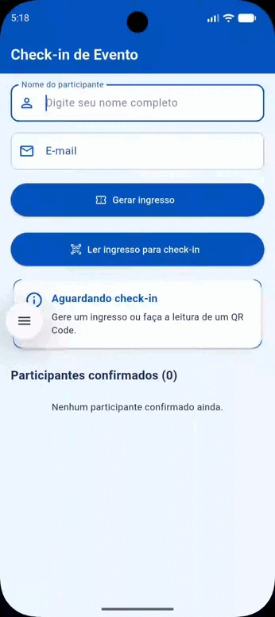

# App de Check-in de Evento
Aplicativo desenvolvido em Flutter para gerar ingressos com QR Code e realizar o check-in de
participantes de um evento. O projeto utiliza uma interface personalizada com tons de azul,
validação de dados e leitura de QR Code pela câmera.

## Funcionalidades
- Preenchimento do formulário com nome e e-mail do participante.
- Validação dos campos obrigatórios e do formato do e-mail.
- Geração de ingresso com QR Code.
- Leitura do QR Code pela câmera para confirmar a presença.
- Identificação de ingressos inválidos e check-ins duplicados.
- Exibição do resultado do check-in e da lista de participantes confirmados.

## Dependências utilizadas
- **`qr_flutter: ^4.1.0`:** geração dos QR Codes dos ingressos.
- **`mobile_scanner: ^5.0.0`:** leitura dos QR Codes utilizando a câmera do dispositivo.

### Principais arquivos

- **`lib/main.dart`:** inicializa o aplicativo e define a tela inicial e o tema.
- **`lib/tema.dart`:** centraliza as cores e os estilos visuais.
- **`lib/screens/tela_checkin_evento.dart`:** controla o formulário, a geração do ingresso, a
  validação dos dados, o processamento da leitura e a lista de participantes confirmados.
- **`lib/screens/tela_leitura_ingresso.dart`:** gerencia a câmera, a leitura do QR Code e o retorno
  do conteúdo lido.
- **`lib/widgets/formulario_ingresso.dart`:** contém os campos de nome e e-mail e o botão de gerar
  ingresso.
- **`lib/widgets/cartao_ingresso.dart`:** apresenta os dados do participante e o QR Code gerado.
- **`lib/widgets/cabecalho_ingresso.dart`:** exibe o cabeçalho visual do ingresso.
- **`lib/widgets/cartao_resultado_checkin.dart`:** apresenta o status e a mensagem do check-in.
- **`lib/widgets/item_participante.dart`:** exibe cada participante confirmado.
- **`lib/widgets/moldura_leitor_qr.dart`:** organiza a área de visualização da câmera e a moldura de
  leitura.
- **`lib/widgets/orientacao_leitor_qr.dart`:** exibe a orientação para posicionar o QR Code diante
  da câmera.
- **`assets/banner_evento.jpg`:** imagem utilizada no cabeçalho do ingresso.
- **`pubspec.yaml`:** configura as dependências e os recursos utilizados pelo Flutter.

## Como executar o projeto

É necessário ter o Flutter SDK e o Android Studio configurados.

1. Clone o repositório:

   ```bash
   git clone https://github.com/tamiresmalvina/app-checkin-evento-flutter.git
   ```

2. Entre na pasta do projeto:

   ```bash
   cd appcheckinevento
   ```

3. Instale as dependências:

   ```bash
   flutter pub get
   ```

4. Execute o aplicativo em um dispositivo ou emulador conectado:

   ```bash
   flutter run
   ```

Para gerar um APK de versão release para instalação em um dispositivo Android:

```bash
flutter build apk --release
```

O arquivo gerado ficará em:

```text
build/app/outputs/flutter-apk/app-release.apk
```

## Demonstração do aplicativo

### 1. Preenchimento do formulário e geração do QR Code

Nesta etapa, o participante informa o nome e o e-mail. Após a validação dos dados, o aplicativo gera
um ingresso contendo suas informações e um QR Code.



### 2. Leitura do QR Code e confirmação de presença

Nesta etapa, a câmera é utilizada para ler o QR Code do ingresso. O aplicativo verifica os dados,
identifica possíveis duplicidades e apresenta o resultado da confirmação de presença.


## Validações do sistema

- O nome do participante não pode ficar vazio.
- O e-mail deve estar preenchido e possuir um formato válido.
- O conteúdo do QR Code deve seguir o formato esperado pelo aplicativo.
- Um e-mail já confirmado não pode realizar outro check-in na mesma execução.
- O resultado informa se o check-in foi realizado, se houve duplicidade ou se o ingresso é inválido.

## Organização do código

O projeto separa a tela principal, a tela de leitura, o tema visual e os componentes reutilizáveis
em arquivos diferentes. Essa organização facilita a manutenção, a leitura e a reutilização dos
componentes, mantendo a lógica principal do check-in separada dos elementos visuais.

## Observação

A lista de participantes é mantida em memória durante a execução atual do aplicativo. O projeto não
implementa persistência em banco de dados; portanto, os registros não são armazenados
permanentemente entre execuções.
